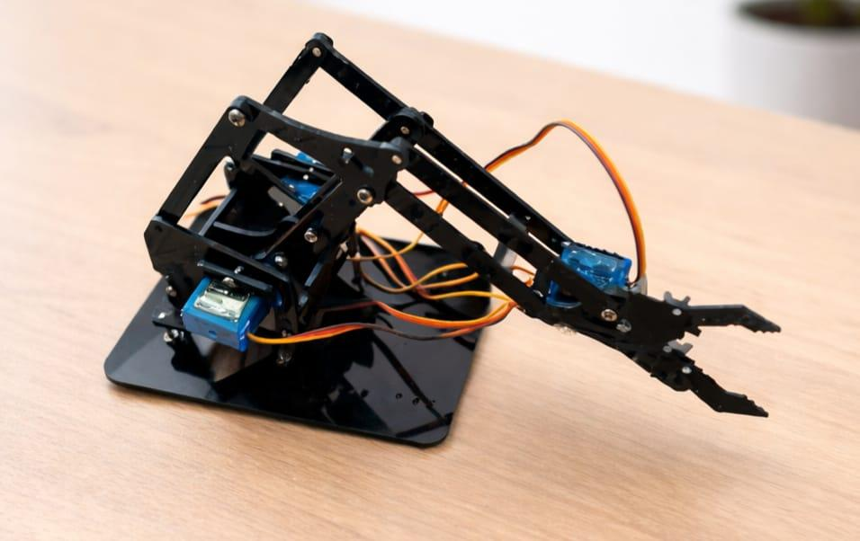
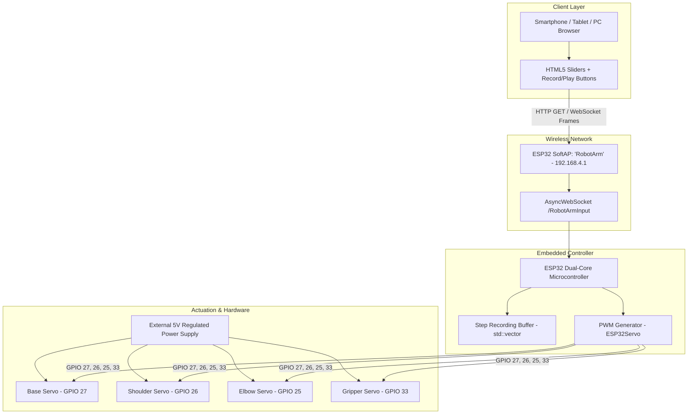

# 🤖 Wi-Fi Controlled Robotic Arm with Real-Time Web Interface & Kinematic Playback

[](https://www.espressif.com/)
[]()
[]()
[]()
[](LICENSE)

> **Developed by:** Mrityun Jay G & Monish S  

An embedded robotic manipulation system powered by the **ESP32** microcontroller, designed for safe remote handling operations in hazardous, toxic, or high-radiation environments. 

The robotic arm features a multi-joint articulating structure driven by PWM servo motors. Unlike traditional systems that rely on short-range Bluetooth, external servers, or specialized mobile applications, this system operates as a **standalone Wi-Fi Access Point hosting an embedded asynchronous WebSocket server**. Users can operate the robotic arm in real time with near-zero latency from any browser-enabled device (smartphone, tablet, or laptop) without needing an internet connection.

---

## 📸 Hardware Prototype & Web Interface

<div align="center">
  <table border="0">
    <tr>
      <td align="center" width="50%">
        
        <br />
        <b>Figure 1: 4-DOF Articulated Acrylic Manipulator with Servo Actuators</b>
      </td>
      <td align="center" width="50%">
        
        <br />
        <b>Figure 2: Responsive HTML5/WebSocket Slider Dashboard & Record Panel</b>
      </td>
    </tr>
  </table>
</div>

> 🎥 **Video Demonstration:** A full demonstration of real-time wireless manipulation is available in the repository: [`wifi robot.mp4`](wifi robot.mp4).

---

## 📌 Key Features & Engineering Innovations

- **Standalone Access Point (No Router Required):** The ESP32 broadcasts its own local Wi-Fi network (`SSID: RobotArm`), allowing field deployment anywhere without external network infrastructure.
- **Bi-Directional WebSocket Pipeline:** Built using `AsyncWebSocket` over port 80. Angular slider changes are pushed with low-latency binary/text frames (`ws://192.168.4.1/RobotArmInput`), ensuring immediate motor response.
- **Trajectory Record & Autonomous Playback Engine:**
  - **Record Mode:** Captures real-time joint positions along with dynamic timestamp deltas (`millis()`).
  - **Play Mode:** Sequentially replays recorded kinematic trajectories with automated smooth homing transitions to prevent jerky motion.
- **Platform-Independent Control:** Fully self-contained HTML5/CSS/JavaScript web dashboard embedded directly in ESP32 Flash memory (`PROGMEM`), requiring no app downloads or installations.
- **Power Isolation Architecture:** Hardware design utilizes dedicated 5V power rails for the servo actuators with a shared common ground to protect the ESP32 logic against inductive back-EMF and brownouts.

---

## 📊 Measured Performance & Benchmarks

From rigorous laboratory testing under real-world operating conditions:

| Parameter | Measured Specification | Evaluation Notes |
| :--- | :---: | :--- |
| **Response Latency** | **80 – 120 ms** | Smooth, near-instantaneous teleoperation via WebSockets |
| **Wireless Operational Range** | **20 – 30 meters** | Reliable indoor/outdoor coverage on 2.4 GHz SoftAP |
| **Joint Positional Accuracy** | **±2°** | Precise PWM duty-cycle mapping across 0°–180° range |
| **Degrees of Freedom (DOF)** | **4-DOF + End-Effector** | Base rotation, shoulder elevation, elbow bend, gripper claw |
| **Operating Voltage** | **5V DC (Servos) / 3.3V (Logic)**| Dual-rail electrical isolation |

---

## 🏗️ System Architecture



---

## 🔌 Hardware Pinout & Wiring

> 📖 For full voltage precautions and common-ground diagrams, see [PIN_CONFIGURATION.md](PIN_CONFIGURATION.md).

| Servo Joint | ESP32 GPIO | Channel | Default Angle | Range |
| :--- | :---: | :---: | :---: | :---: |
| **Base (Rotation)** | `GPIO 27` | PWM | 90° | 0° – 180° |
| **Shoulder (Elevation)** | `GPIO 26` | PWM | 90° | 0° – 180° |
| **Elbow (Reach)** | `GPIO 25` | PWM | 90° | 0° – 180° |
| **Gripper (Claw)** | `GPIO 33` | PWM | 90° | 0° – 180° |

---

## 💻 Getting Started

### 1. Hardware Requirements
- **ESP32 Dev Module** (30-pin or 38-pin)
- **4× Servo Motors** (MG90S metal gear or SG90)
- **4-DOF / 5-DOF Acrylic or 3D-Printed Robotic Arm Frame**
- **External 5V 2A–3A DC Power Supply** (or 5V Power Bank)
- Jumper Wires & Breadboard

### 2. Software & Libraries
Install the following libraries in Arduino IDE:
- `WiFi.h` (Built-in ESP32 core)
- `ESPAsyncWebServer` by me-no-dev
- `AsyncTCP` by me-no-dev
- `ESP32Servo` by Kevin Harrington

### 3. Uploading Firmware
1. Open `robotic_arm_firmware.ino` in Arduino IDE.
2. Under **Tools > Board**, choose **ESP32 Dev Module**.
3. Select your serial port and click **Upload**.

### 4. Operating the Robotic Arm
1. Power up the external 5V power supply and ESP32.
2. On your smartphone or laptop, open Wi-Fi settings and connect to:
   - **SSID:** `RobotArm`
   - **Password:** `12345678`
3. Open any web browser (Chrome, Safari, Firefox) and navigate to:
   ```text
   http://192.168.4.1
   ```
4. Adjust the joint sliders in real time, or tap **Record** to teach movements and **Play** to execute automated loops!

---

## 🛡️ License
Distributed under the [MIT License](LICENSE).
